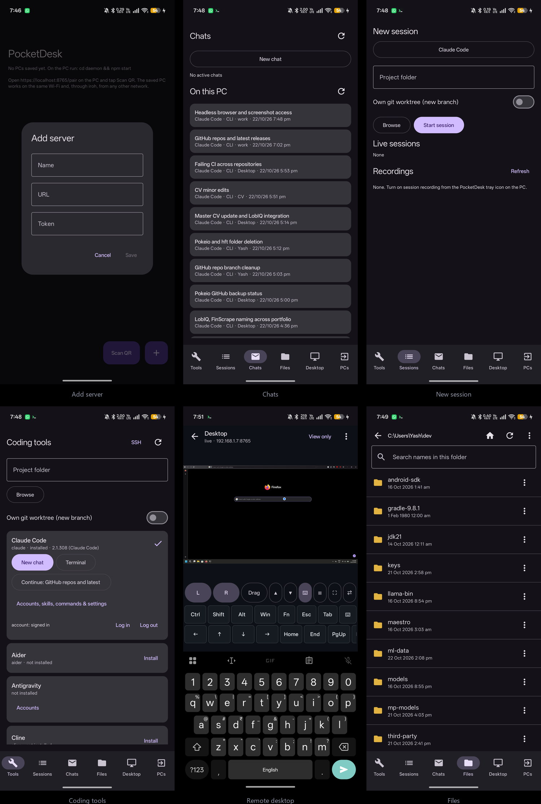

# PocketDesk

> **Run AI coding agents on your PC, control them from your phone.**

[](https://github.com/Yash-Awasthi/PocketDesk/actions/workflows/ci.yml)
[](https://github.com/Yash-Awasthi/PocketDesk/releases/latest)
[](LICENSE)
[](https://nodejs.org)
[](#protocol-v1)
[](https://developer.android.com)
[](#plugin-system)
[](#testing)

**No cloud. No accounts. Your machine, your data, your agents.**

PocketDesk is a self-hosted bridge between your Windows/Linux/Mac PC and your Android phone. Install AI coding agents (Claude Code, Codex, Gemini CLI, OpenCode, Qwen Code, or any CLI) on your PC, and drive them from a sleek mobile app over WebSocket — with live terminal streaming, file transfer, AI chat, and a **proposal/approval system** for agent safety.

---

## 📸 Screenshots

<a href="docs/screenshots/showcase.jpg"></a>

---

## ✨ Features

| Feature | Description |
|---------|-------------|
| 🖥️ **Live Terminal** | Real-time PTY streaming with extra keys (Esc, Tab, Ctrl+C/D/Z, arrows) — seq-numbered output with missed-output backfill after reconnect |
| 💬 **AI Chat** | ChatGPT-style conversation, streamed token by token (Claude Code runs with `--include-partial-messages`), with tool calls shown the moment the agent starts them, approvals answered inside the chat, a model and permission mode for the next message only, and a **slash command picker**: type `/` to list the agent's built-in commands, skills (plugin skills included) and your custom commands |
| 📚 **Agent history** | Every conversation the coding agents saved on the PC, grouped by agent and app: Claude Code (CLI and VS Code extension), Codex (CLI and VS Code extension), Copilot Chat, Cline and Roo Code in VS Code and its forks, Cursor and Antigravity. Read any transcript; **continue** a Claude Code or Codex conversation as a phone chat or in its terminal UI; open the project in the IDE it came from (`history_*`) |
| 👥 **Account switching** | Save each login of Claude Code, Codex, Gemini, Cursor and Antigravity on the PC and switch between them from the phone; the replaced login is always kept. Tokens stay on the PC. Switching asks first, logging out or forgetting a login takes your fingerprint, and Cursor and Antigravity must be closed while they switch (`accounts_list`, `account_save`, `account_switch`, `account_forget`) |
| 🧩 **Agent panel** | One screen per agent (Claude Code, Codex, Gemini, Qwen, OpenCode, Copilot, Cline): recent conversations, skills, custom slash commands and its settings and memory files (`settings.json`, `CLAUDE.md`, `config.toml`, `AGENTS.md`, …; tokens and API keys inside them are masked before they leave the PC and kept when you save) — view, edit, or run a skill or command as a chat (`agent_panel`, `agent_doc`, `agent_file_set`) |
| 📊 **Dashboard** | Real-time stats, activity timeline, plugin status, connected clients |
| 📁 **Files** | A Files tab for your home folder: open or share a file in any phone app, save it to Downloads, upload, rename, create folders, delete to the Recycle Bin, search by name, copy a path. Long press to select several files for download or delete, download a folder as a .zip, sort by name, date or size, and see thumbnails of images (`fs_op`, `fs_search`, `fs_zip`, `fs_thumb`) |
| 🔐 **TLS + Pinning** | Self-signed cert support with SHA-256 fingerprint pinning |
| 📦 **Auto-Install** | One-tap npm/pip install with live progress output |
| 🪟 **IDE Launch** | Open any installed desktop IDE or GUI app on the PC from the phone, at the project folder you picked — the window opens on the PC, then the Desktop screen drives it (`gui_open`) |
| 🔎 **App discovery** | Everything installed, not only what ships a manifest: Start Menu shortcuts, `/Applications` bundles and `.desktop` entries for GUI apps, PATH for command-line tools. Search on the Tools screen, **Open** for a GUI app, **Run** for a CLI tool in a PTY (`apps_discover`) |
| 🔌 **Plugin System** | Drop a JS file to extend the daemon — no core changes needed |
| 📝 **Agent approvals** | Claude Code's permission prompts come to the phone as a card with the command or a red/green diff: Deny, Allow, or Allow all for that session, also from the notification. Each chat picks its permission mode (ask, auto-accept edits, plan only, full access) |
| 📱 **Multi-PC** | Connect to multiple PCs, each with pinned certificates |
| 🔔 **Background Notify** | Get notified when sessions end while the app is in background |
| 📈 **Activity Monitor** | Per-session working/asking/quiet states |
| 🖨️ **Desktop Control** | Watch and drive the PC screen from the **browser and the Android app**: hardware video up to 60 fps, negotiated to the best codec both ends support — AV1 or HEVC where the phone can decode them (about 30–50% less data than H.264), H.264 otherwise (NVENC, Quick Sync, AMD AMF, Apple VideoToolbox or VA-API; the browser decodes H.264 with WebCodecs), the PC's sound streamed alongside as AAC, any monitor, the PC pointer drawn on the viewer as a small dot centred on the click point; touch gestures (two-finger scroll in both directions, two-finger tap for right click, three-finger tap for middle click, three-finger swipes to switch desktops or Spaces and show every window, hold then move to drag, pinch to zoom), a screen switcher on the picture when the PC has several monitors, pointer placement that is exact on Retina and mixed-DPI setups plus a manual corner calibration in the menu, a one-tap shortcut bar that follows the PC's OS (Ctrl shortcuts, Win and Task Manager on Windows; Cmd shortcuts, Spotlight, Mission Control and Force Quit on a Mac), media and volume keys, an app drawer of every installed program, held keys and buttons, a keyboard or mouse attached to the phone, and the frame delay shown live (`desktop_*`; Windows, macOS and Linux/X11). |
| 📋 **Clipboard & file drop** | Text, images and copied files move between the PC and the viewer while the desktop is open; files sent from the phone or browser are pasted straight into the focused PC window. |
| 👁 **Access control** | A connection password is required on every connect; the PC owner can pause control (view-only) from the pairing page, and viewers can join view-only. A **Remote access** switch at the top of the pairing page disconnects and refuses every phone and browser until it is switched back on, and **Uninstall PocketDesk** at the bottom right removes it after a confirmation (optionally with its settings). |
| 🎥 **Session recording** | Optional MP4 of the watched screen, asciicast of terminals, and a log of every viewer, approval and file sent. |
| ⏰ **Wake-on-LAN** | Wake a sleeping PC from the phone on the same network. |
| 🟥 **Viewing frame** | A red edge around every monitor while someone is connected, seen only at the PC |
| 🔌 **PC power** | Lock, sign out, sleep, restart or shut down the PC from the phone (`pc_power`) |
| 🔑 **Two-factor pairing** | Optionally require a code from an authenticator app before a new device may pair; set up on the PC's settings page (`/access/totp/*`) |
| 🛡️ **SSH Bastion** | A real jump host: log in as `user@host` with your registered key, the access rule is checked, and the channel is proxied to the target with byte accounting (`bastion_*`) |
| 🔒 **SSH Server Control** | A real SSH listener on the PC: per-user password/public-key auth, command allowlists enforced before a command runs, PTY shells, session recording (`sshserver_*`) |
| 📇 **Connection Profiles** | Real SSH, SFTP and VNC connections from saved profiles, host-key trust-on-first-use, OpenSSH key generation kept out of the protocol (`profile_*`/`hostkey_*`/`sshkey_*`) |
| 🔐 **SSH Screen** | Profiles, key generation, known host keys and start/stop for both PC-side listeners — on the browser client's SSH tab and on the phone, reached from the Tools screen |
| ⚡ **Keep-Awake** | PC stays awake while agents run (per-process, never touches your power settings) |
| 🌿 **Git Panel** | Branch/diff/log/status of any repo on the PC, read-only |
| ⏭️ **Prompt Queue** | Queue follow-ups while the agent works — they drain automatically when the turn finishes |
| ✅ **Todo Boards** | Live task lists per session — auto-derived from the agent's markdown checkboxes |
| ⏰ **Scheduler** | Auto-continue loops: fire a prompt on an interval, after a delay, or N times |
| 📣 **@file Mentions** | Reference PC-side files in prompts — content is inlined before the agent sees it |
| 🩺 **Doctor** | One message returns a full self-diagnosis of the daemon and its agents |
| ⏱️ **Approval Auto-Deny** | Unattended agents never stall — unanswered approvals are auto-denied on a timer |
| 💰 **Usage Dashboard** | Per-session token + cost aggregates straight from the agent's stream events |
| 📶 **Auto-Reconnect** | The app reconnects with exponential backoff + jitter and replays only missed output. Switching between Wi-Fi and mobile data moves the link to iroh (or back to the LAN) by itself, and after a PC restart the phone returns to the LAN address rather than staying on the relay |

---

## ⚡ Quick Install

**Windows:** download **PocketDesk-Install.exe** from the
[latest release](https://github.com/Yash-Awasthi/PocketDesk/releases/latest) and double-click it.
No admin rights and nothing to install first. Windows may say it protected your PC, because the file
is not code-signed: choose **More info**, then **Run anyway**.
**PocketDesk-Uninstall.exe** from the same release removes it and stops every PocketDesk process.

Or the same installer from PowerShell:
```powershell
irm https://raw.githubusercontent.com/Yash-Awasthi/PocketDesk/master/install.ps1 | iex
```

On a PC with **Smart App Control** on, Windows refuses the small launcher the installer compiles,
so the installer detects it and runs the daemon from signed programs only (`conhost`, PowerShell and
the bundled Node.js, through `run-daemon.ps1`); the Start Menu shortcut then opens pairing through
`open-pairing.ps1`. Nothing to do on your side.

It downloads the daemon with its own Node.js and ffmpeg, starts it hidden at logon (it shows only
in Task Manager, as PocketDesk.exe), adds a **PocketDesk** shortcut to the Start Menu, and opens the
pairing QR. Scan it with the app and you are done. Clicking the shortcut later starts PocketDesk,
or shows the pairing QR again if it is already running.
To remove it: **Settings > Apps > Installed apps > PocketDesk > Uninstall**.
Full guide, updating and uninstalling: [docs/SETUP-PC.md](docs/SETUP-PC.md).

**macOS / Linux:**
```bash
curl -fsSL https://raw.githubusercontent.com/Yash-Awasthi/PocketDesk/master/install.sh | bash
```
On macOS you can instead download **PocketDesk-mac.zip** from the
[latest release](https://github.com/Yash-Awasthi/PocketDesk/releases/latest), unzip it and
double-click **PocketDesk-Install.command** (the first time, right-click > **Open**, since it is not
notarized). Both need [Node.js](https://nodejs.org) 24 or newer installed first.
The daemon runs hidden in the background, like on Windows: a LaunchAgent on macOS (seen only in
Activity Monitor) and a systemd user service on Linux. It serves terminals, files, chat and agent
control. Open **PocketDesk** from Spotlight, Launchpad or the app menu to pair a phone and change
settings, or use `pocketdesk` (`pair`, `status`, `stop`, `start`). On macOS, screen sharing and
remote control also work once you grant **Screen Recording** and **Accessibility** to the daemon
(System Settings → Privacy & Security; prompted on first use); with ffmpeg installed
the screen streams as hardware video (ScreenCaptureKit + VideoToolbox: HEVC or H.264) and the Mac's
sound comes with it; without those it falls back to still frames. On Linux (X11), the installer adds
ffmpeg, xdotool and xrandr, and the screen streams with the PC's sound; Wayland sessions have no
X server to grab, so sign in with X11/Xorg for screen sharing (terminals, files and agents work
either way).

**Manual:**
```bash
git clone https://github.com/Yash-Awasthi/PocketDesk.git
cd PocketDesk/daemon
npm install
npm start
```

Runtime dependencies are `ws`, `node-pty`, `ssh2` (the SSH server, jump host
and connection profiles) and `@number0/iroh` (reaching the PC from any network).

---

## 📱 Connect your phone (complete guide)

The Android app is the primary remote: chats, live terminals, the agent fleet,
the Freebuff control plane, files, models and **full desktop control** — every
daemon feature is reachable from it. It requires Android 11 (API 30) or newer.

### Step 1 — Get the app on your phone

Pick one:

- **Download the APK from CI** (easiest): open the repo's
  [Actions tab](https://github.com/Yash-Awasthi/PocketDesk/actions) → click
  the latest green run → download the **PocketDesk-debug-apk** artifact →
  unzip → copy `app-debug.apk` to your phone and install it
  (allow "install unknown apps" when asked).
- **Build it yourself**: `cd app && ./gradlew assembleDebug` → APK at
  `app/app/build/outputs/apk/debug/app-debug.apk`.

On first launch the app asks for **notifications** and, on Android 17 and later, for access to
**devices on your local network**. Allow the second one: without it Android drops every connection
to the PC's LAN address and the app can only reach the PC through the iroh relay, which is slower.

### Step 2 — Start the daemon on the PC

```bash
cd PocketDesk/daemon
npm start
```

The banner prints everything: the pairing URL, the WebSocket URL and the full
auth token (also persisted to `~/.pocketdesk/config.json` —
`%USERPROFILE%\.pocketdesk\config.json` on Windows).

### Step 3 — Pair

1. **QR pairing (easiest)** — on the PC, open the pairing link from the banner
   (`https://localhost:8765/pair?k=<token>`; the **PocketDesk** Start Menu shortcut opens it) and
   scan the QR **with the PocketDesk app** (tap **Scan QR** on the PC list). The app
   receives the URL, token and (with TLS) the cert fingerprint automatically.
   > Note: the QR page is loopback-only by design — open it on the PC itself,
   not on the phone.
2. **Manual entry** — in the app tap **＋**, then enter
   `wss://<pc-ip>:8765/ws` (find the PC's IP with `ipconfig` / `ip a`) and the
   token from the banner or `config.json`.
3. **Browser smoke test** — open `http://localhost:8765` on the PC, paste the
   token, hit **Connect**, then **＋ New Chat** → pick an installed agent →
   prompt → **Start**. The browser client also carries a **Tools** tab:
   a read-only Git panel for any repo path on the PC, the `doctor` self-check,
   and a search over everything installed with **Open** for a GUI app or
   **Run** for a command-line tool.

When the app's status bar shows **Connected**, you're paired.

### Step 4 — Control everything

| App screen | What you can do |
|---|---|
| **Tools** | See every managed agent CLI (Claude Code, Codex, OpenCode, Antigravity, Copilot, Cline, ZCode, Gemini, Qwen, Aider) — install/uninstall, versions, account login — plus the desktop IDEs found on the PC, each with an **Open** button. **Skills, commands & settings** on an agent's card opens its agent panel |
| **Sessions** | Live PTY terminals of any session — full keyboard streaming, like SSH |
| **Chats** | Create agent chats, stream replies token-by-token, `/` for the command picker, pick the **model** (opus/sonnet/haiku…) and the permission mode per chat, cancel a running turn. **On this PC** lists every agent's saved conversations, filterable by agent and app, with **Continue in chat**, **Resume in terminal** and **Open in <IDE>** |
| **Desktop** | AnyDesk-style view of the whole PC screen: tap = move+click, long-press = right-click, drag = move, two-finger/▲▼ = scroll. **⌨** types with the phone's own keyboard, plus a bar for what it lacks against a full PC keyboard: sticky Ctrl/Shift/Alt/Win, Fn for F1–F12, Esc, Tab, arrows, Ins/Del/Home/End/PgUp/PgDn, PrtSc, Caps/Num/Scroll Lock, Pause, Menu, media and volume. **⛶** is true fullscreen: the picture alone, taps still click, with only an exit button and a switch that turns mouse and keys off |
| **Freebuff** | The Freebuff desktop app itself: open/quit, login state and **logout**, browse & run all skills, view & edit allowlisted configs (each edit backed up) |

Install agents from the phone too: any tool card marked "not installed" has an
**Install** button (one-tap npm/pip install with live progress).

**First terminal session in a new folder:** Claude Code opens with a workspace
trust prompt whose default option is *No, exit* — pressing Enter straight away
quits it. Use the **↓** key in the terminal key row to select *Yes, I trust this
folder*, then Enter. After that the REPL appears and typing works normally.

### 🧠 Claude Code from the phone

Claude Code is the agent the app is built around. Its card sits first on the Tools screen, with
**New chat**, **Terminal** and **Continue** (the newest Claude Code conversation on the PC that is not
still open there), plus **Skills, commands & settings**. In a chat:

- replies stream token by token, and each tool call shows the moment Claude starts it;
- `/` lists Claude's commands and skills, plugin skills included, and your custom commands;
- **Next message** picks a model and permission mode for one message; the header sets the chat's own;
- with **Ask on phone**, every permission prompt is answered by a card inside the chat (Deny, Allow,
  Allow all), or from the notification when the app is in the background;
- every Claude Code conversation on the PC, from the CLI or the VS Code extension, is listed under
  **On this PC** and continues as a chat or in the terminal UI. One written to in the last two minutes
  counts as still open on the PC and is not offered, so a running session is never forked.

### 🦾 Controlling Freebuff itself from the phone

The Freebuff tab (browser) / Freebuff screen (app) gives full control of the
Freebuff desktop app on the PC: app status (running/exe/profile), **open &
quit**, login state and **logout**, all **28 skills** in `~/.claude/skills`
(view SKILL.md or run a skill as a real agent chat), and allowlisted
**config files** with view/edit (every edit is backed up as `.bak`).

### 🤖 Agent fleet & model selection

Beyond Claude Code, Codex and OpenCode the daemon manages **GitHub Copilot
CLI, Cline, ZCode, Gemini, Qwen and Aider** — install and launch any of them
from the phone. Chats support **model selection** where the CLI offers it
(e.g. Claude: opus / sonnet / haiku) via the model picker in the chat toolbar;
the choice drives the agent's runtime flags.

### 🪟 Desktop IDEs

Some of these agents ship as desktop applications rather than CLIs. The daemon
finds the ones installed on the PC and the Tools screen offers **Open** for
each: **VS Code, Zed, Antigravity, OpenCode Desktop** and **Freebuff Desktop**.
There is no PTY behind them, so opening starts the window on the PC and the
**Desktop** screen is how you see and drive it from the phone.

### 🖥️ Shared terminals

A terminal runs on the PC (PowerShell from Tools, or any agent CLI), and the phone and local programs
all see the same one. It keeps the PC's size; the phone shows it scaled down
(pinch to zoom). On the PC, the `pocketdesk` command drives it, so Claude Code can work in the
terminal the phone is watching:

```
pocketdesk new [--cwd DIR] [tool]     # starts PowerShell (or a tool id) and prints its id
pocketdesk list                       # id, tool, size, folder
pocketdesk send s1 "npm test" Enter   # tmux-style key names: Enter Tab Escape BSpace Up C-c ...
pocketdesk read s1                    # the screen as it looks now, as text
pocketdesk attach s1                  # use it in this window; Ctrl+] leaves it running
pocketdesk resize s1 120 40
pocketdesk kill s1
```

### 📱 Your phone on the PC

`https://localhost:8765` on the PC is the phone and nothing else, in two tabs:

- **Phone screen**: the phone's screen, controlled with the mouse and keyboard (click taps, a held
  click long-presses, drag swipes, the wheel scrolls; click the picture, then type). Recent apps get
  their own panes, as many as fit the width; click one to bring it to the front. **Swap** (here or
  on the phone's Desktop screen) picks which device controls the other.
- **Phone storage**: the phone's shared storage: browse, download, upload (button or drag and drop),
  new folder, rename, delete.

Log in once with the token from `%USERPROFILE%\.pocketdesk\config.json` (or open
`https://localhost:8765/#t=<token>`); the page remembers it. The phone asks its owner through
Android's own prompt for every screen share and shows a notification while shared; Android ends the
share when the phone locks. Tapping and typing need **PocketDesk PC control** switched on once under
Accessibility (sideloaded installs: App info > ⋮ > Allow restricted settings first); the storage tab
needs **All files access** for PocketDesk (the phone shows a notification that opens it). Apps that
mark their content as sensitive stay black, as in any screen share.

### 📚 Every agent's past conversations

The Chats screen has an **On this PC** section: the conversations each coding agent saved on the PC,
newest first, with a chip per agent and app.

| Agent | Where it is read from | Continue from the phone |
|---|---|---|
| Claude Code (CLI and VS Code extension) | `~/.claude/projects/*/*.jsonl` | Yes: as a chat (`--resume <id>`) or in the terminal UI |
| Codex (CLI and VS Code extension) | `~/.codex/sessions/**/rollout-*.jsonl` | Yes: as a chat or `codex resume <id>` |
| GitHub Copilot Chat | `<editor>/User/workspaceStorage/*/chatSessions` | Read only; **Open in <IDE>** |
| Cline, Roo Code | `<editor>/User/globalStorage/<extension>/tasks` | Read only; **Open in <IDE>** |
| Cursor | `Cursor/User/globalStorage/state.vscdb` | Read only; **Open in Cursor** |
| Antigravity | `~/.gemini/antigravity/conversation_summaries.db` | Read only; **Open in Antigravity** |

`<editor>` is any VS Code family app: VS Code, Insiders, Cursor, Windsurf, Antigravity, VSCodium,
Trae, Kiro. Only titles and text reach the phone; file paths stay on the PC. The chat panels inside
those editors have no outside API, so typing into them is done on the **Desktop** screen.

---

## 📖 Operations Manual

### Starting the daemon

```bash
cd PocketDesk/daemon
npm start          # first run generates + persists the token
```

The banner prints everything: local URL, WebSocket URL, the full auth token
(dev only), the pairing-QR URL, and the iroh endpoint ID. Everything
also persists to `~/.pocketdesk/config.json`:

```json
{
  "port": 8765,
  "token": "<your-token>",
  "iroh": { "enabled": true, "relays": [] }
}
```

Environment overrides (win each over the config file): `RH_PORT`, `RH_TOKEN`,
`RH_IROH` (`0` disables iroh), `RH_IROH_RELAYS` (comma-separated relay URLs). TLS: `node scripts/gen-cert.js`
then set `tls.enabled: true` in the config.

On Windows the installer starts the daemon hidden at logon; see
[docs/SETUP-PC.md](docs/SETUP-PC.md).

### How access works

The phone never touches your PC directly unless it's on the same network.
Authentication is always the same: the app sends the token once at connect
(`hello`), and every command thereafter is authenticated by that socket.

| Mode | Phone URL | When to use | PC needs |
|---|---|---|---|
| **LAN** | `wss://<pc-ip>:8765/ws` | Phone on same Wi-Fi | Nothing special |
| **Anywhere (iroh)** | `iroh://<ticket>`, saved by the pairing QR | Any network, no setup | Outbound internet only |
| **Tailscale/VPN** | `ws://<tailscale-ip>:8765/ws` | You manage a tailnet | Tailscale on both ends |
| **Port-forward** | `wss://your.domain:8765/ws` (TLS!) | You control the router | Forwarded port + TLS cert |

**LAN (same Wi-Fi) — default.** Start the daemon, scan the QR at
`http://localhost:8765/pair?k=<token>`, done.

**Anywhere — iroh.** The same QR also stores an iroh ticket with the entry;
when the LAN address does not answer, the app retries over iroh, so one saved
PC works at home and away. The phone dials the PC by its public key: iroh
hole-punches a direct QUIC connection when the two networks allow it (most do)
and otherwise falls back to an end-to-end encrypted relay. No VPN, no port
forward, no account. The phone is bound to the key it paired from, so a copied
device token is useless on another phone. Desktop video goes one QUIC stream
per GOP, so a bad link skips ahead instead of falling seconds behind, and the
quality preset steps down while the link cannot keep up. By default n0's free
public relays are used; [docs/RELAY.md](docs/RELAY.md) sets up your own.
Measurements: [docs/TRANSPORT-BENCH.md](docs/TRANSPORT-BENCH.md).

**Switching networks.** Turning Wi-Fi off mid-session moves the link to iroh within a few seconds,
and turning it back on returns to the LAN address, with no app restart. Android hides interface
changes from iroh, so the app rebuilds its iroh endpoint on every network change.

**Tailscale** still works if you already run it on both ends:
`ws://<tailscale-ip>:8765/ws` behaves exactly like LAN. It is not needed any more.

### Security checklist

- The token is the root credential — treat it like a password. It lives in
  `~/.pocketdesk/config.json` and prints in the banner (dev only).
- `/pair` (the QR page) is served **only** to loopback — never exposed.
- Put TLS on for anything beyond localhost: `node scripts/gen-cert.js`, set
  `tls.enabled: true`, and pin the fingerprint shown in the app.
- iroh relays only ever see end-to-end encrypted traffic; the token still gates
  every command, and a device is bound to the iroh key it paired from.
- Revoking a phone = change the token (and update your other devices).

---

## 🏗️ Architecture

```
┌──────────────┐          WebSocket (JSON)         ┌──────────────────┐
│              │ ◄────────────────────────────────► │                  │
│  Android App │          LAN / iroh (QUIC)         │  harnessd        │
│  (Kotlin)    │                                    │  (Node.js)      │
│              │                                    │                  │
│  ┌────────┐  │                                    │  ┌────────────┐  │
│  │Terminal│  │                                    │  │  Sessions  │  │
│  │ Screen │  │                                    │  │  (PTY)     │  │
│  ├────────┤  │                                    │  ├────────────┤  │
│  │ Chat   │  │         propose → approve           │  │  Chat      │  │
│  │ Screen │  │                                    │  │  (Streaming│  │
│  ├────────┤  │                                    │  ├────────────┤  │
│  │ Dash-  │  │                                    │  │  Plugins   │  │
│  │ board  │  │                                    │  │  (Hooks)   │  │
│  └────────┘  │                                    │  ├────────────┤  │
│              │                                    │  │  Registry  │  │
│              │                                    │  │  (Tools)   │  │
└──────────────┘                                    │  └─────┬──────┘  │
                                                    │        │         │
                                                    │   ConPTY / spawn │
                                                    │        │         │
                                                    │  ┌─────▼──────┐  │
                                                    │  │ claude /    │  │
                                                    │  │ codex /     │  │
                                                    │  │ gemini /    │  │
                                                    │  │ opencode    │  │
                                                    │  └────────────┘  │
                                                    └──────────────────┘
```

Every coding agent is described by a JSON manifest. The daemon scans PATH, reports what's installed, and streams terminal sessions bidirectionally:

```json
{
  "id": "kimi",
  "name": "Kimi Code",
  "adapter": "terminal",
  "bin": "kimi",
  "install": { "npm": "@moonshot-ai/kimi" }
}
```

---

## 🔌 Plugin System

PocketDesk has a plugin system inspired by deepseek-harness and claude-code-hermit. Plugins extend the daemon with lifecycle hooks — **no core changes needed**.

### Quick Start

Drop a `.js` file in `daemon/src/plugins/`:

```javascript
export default {
  name: "my-plugin",
  version: "1.0.0",
  hooks: ["onMessage", "onConnect"],

  init(ctx) { },          // Called once at startup
  start(ctx) { },         // Called when daemon starts listening
  stop(ctx) { },          // Called on graceful shutdown
  onConnect(ctx, ws) { }, // New WebSocket connection
  onDisconnect(ctx, ws) { }, // WebSocket closed
  onMessage(ctx, ws, msg) { }, // Incoming message
};
```

### Hook Return Values

| Return | Effect |
|--------|--------|
| `undefined` | Continue processing normally |
| `{ block: true }` | Prevent message from reaching the handler |
| `{ modify: {...} }` | Replace the message before handling |

### Built-in Plugins

| Plugin | Description |
|--------|-------------|
| `logger-plugin.js` | Logs all WebSocket events with timestamps |
| `metrics-plugin.js` | Collects session metrics (message count, uptime) |
| `auth-plugin.js` | Optional token-based auth (replaces built-in) |
| `proposal-plugin.js` | Gates sensitive actions through human approval |

### Plugin Context

Plugins receive a `ctx` object:

- `ctx.sessions` — session manager (create, attach, detach, write, kill)
- `ctx.chat` — chat manager (create, attach, send, cancel)
- `ctx.proposals` — proposal manager (create, approve, reject)
- `ctx.broadcast` — send messages to all connected clients
- `ctx.registry` — tool discovery and installation
- `ctx.config` — daemon configuration (port, token, dataDir)

---

## 📝 Proposal System

**Claude Code prompts on the phone.** Every `claude` the daemon starts, in a chat or a terminal, gets a
`PermissionRequest` hook through `--settings` (`tool_approval.js`, `approve-hook.js`). When Claude Code
would ask for permission, the hook posts the tool call to the daemon's local endpoint, the phone shows
it, and the answer goes back to Claude Code. Allow all trusts the rest of that agent session. Nobody
answering within about 4.5 minutes leaves the decision to Claude Code's own prompt. If your Claude Code
settings use `bypassPermissions`, nothing asks until a chat's permission menu is set to **Ask on phone**.

The same proposals are open to plugins, inspired by claude-code-hermit's operator-gated pattern:

1. Agent suggests an action (file write, command, network request)
2. Proposal card appears on the phone
3. User clicks **Approve** or **Reject**
4. Action executes or is blocked

```javascript
// Create a proposal
ctx.proposals.create({
  type: "command_execute",
  summary: "Run npm build",
  detail: { command: "npm run build" },
  sessionId: "abc123",
});

// Wait for decision
const { status } = await ctx.proposals.waitForDecision(proposal.id);
// status: "approved" | "rejected" | "expired"
```

Proposals auto-expire after 5 minutes.

---

## 🆚 Comparison

| | PocketDesk | claude-code-hermit | OpenAI Codex |
|---|---|---|---|
| **Type** | Multi-agent bridge | Claude Code plugin | Local coding agent |
| **Agents** | Any CLI tool | Claude only | Codex only |
| **Mobile App** | ✅ Android (Kotlin) | ❌ | ❌ |
| **Live Terminal** | ✅ Full PTY | ❌ | ❌ |
| **Plugin System** | ✅ JS plugins + hooks | ✅ Extension points | ❌ |
| **Proposal/Approval** | ✅ Built-in | ✅ Operator-gated | ❌ |
| **Dashboard** | ✅ Real-time stats | ❌ | ❌ |
| **AI Chat** | ✅ Streaming | ✅ (Claude native) | ✅ (Codex native) |
| **TLS + Pinning** | ✅ SHA-256 | ❌ | ❌ |
| **Cost** | Free | Free (needs Claude sub) | Free (needs API key) |
| **Language** | Node.js | TypeScript | Rust |

---

## 📖 Protocol (v1)

JSON frames; binary payloads are base64.

**Client → Server:**
`hello` · `detect` · `install` · `create` · `attach {since?}` · `detach` · `in` · `resize` · `kill` · `fs` · `fread` · `fwrite` · `chatsession` · `chatmsg {id, text, model?, mode?}` (model and mode for this message only) · `chatcancel` · `history_list {agent?}` · `history_get {agent, id}` · `history_resume {agent, id, mode?: "terminal"}` · `agent_panel {agent}` · `agent_doc {agent, kind: skill|command|file, name}` · `agent_file_set {agent, name, content}` · `fs_op {op: mkdir|rename|delete}` · `fs_search {path, q}` · `propose` · `approve {id, all?}` · `reject` · `proposal_list` · `pc_power {action}` · `totp_status` · `totp_setup` · `totp_enable {code}` · `totp_disable {code}` · `chat_history` · `pin`/`unpin` · `gui_open {harness|path, cwd}` — open a desktop IDE on the PC at a project folder · `apps_discover {q, refresh}` — search everything installed
<details>
<summary>Absorbed-feature messages</summary>

`prompt_enqueue` · `prompt_queue` · `prompt_remove` — queued follow-ups ·
`todos_set` · `todos_get` · `todos_status` — live todo boards (+ `todos_updated` broadcasts) ·
`schedule_create` · `schedule_list` · `schedule_pause` · `schedule_resume` · `schedule_cancel` — auto-continue runs ·
`doctor` — self-diagnosis report ·
`approval_waiting` — chats on the auto-deny countdown ·
`usage_list` · `usage_get` — token/cost dashboards ·
`sshserver_start` · `sshserver_stop` — bind/release the PC's own SSH listener ·
`bastion_start` · `bastion_stop` — bind/release the jump host ·
`profile_connect {id, protocol, password?, passphrase?}` — real SSH/SFTP/VNC connect ·

`stats` — host CPU/mem/uptime · `git_status` · `git_diff` · `git_log` · `git_branches` — read-only repo inspection ·
`activity_list` — per-session activity states
</details>

**Server → Client:**
`welcome` · `manifests` · `sessions` · `created` · `replay` · `out {seq}` · `exit` · `progress` · `fs` · `fchunk` · `fwritten` · `fs_result` · `fs_found` · `chatreplay` · `chatuser` · `chatdelta` · `chartool {toolId?}` (same toolId again = the call's completed input) · `chatstate` · `chat_info {model, permissionMode, commands, pocketdesk}` · `history` · `history_item` · `agent_panel` · `agent_doc` · `agent_file_saved` · `proposal_created` · `proposal_approved` · `proposal_rejected` · `proposal_expired` · `pc_power` · `totp_status` · `totp_setup` · `activity` · `gui_opened` · `apps` · `error`

Every `out` frame carries a monotonic `seq`; on reconnect send `attach {id, since: <last seq>}` and the daemon replays only what you missed.

---

## 🧪 Testing

```bash
cd daemon
npm.cmd test                    # full suite
node test/smoke.test.mjs        # session smoke tests
node test/features.test.mjs     # absorbed-features suite (backfill, stats, git, activity, accounts)
```

The suite never leaves loopback. To exercise the SSH, SFTP and VNC transports
against a machine you actually own:

```bash
node scripts/hw-probe.mjs --host 192.168.1.20 --user dev --key ~/.ssh/id_ed25519
node scripts/hw-probe.mjs --vnc-host 192.168.1.30 --vnc-password secret
```

It connects, runs one command, uploads and downloads a file and compares it byte
for byte, then reports the VNC framebuffer geometry the server announced.

---

## 🎛️ Environment knobs

| Variable | Default | Purpose |
|----------|---------|---------|
| `RH_PORT` / `RH_TOKEN` | config file | Listen port and auth token |
| `RH_AWAKE` | `auto` | Keep PC awake: `off` / `auto` (while sessions run) / `on` |
| `RH_APPROVAL_TIMEOUT_MS` | `120000` | Auto-deny an agent stuck waiting for approval (0 disables) |
| `RH_QUIET_MS` | `20000` | Silence before a session counts as *quiet*  |
| `RH_IDLE_KILL_MINUTES` | off | Kill live sessions idle longer than N minutes |
| `RH_CLI_PORT` | `4679` | Local CLI endpoint (`/sessions /status /query /term`), used by `pocketdesk`; needs `Authorization: Bearer <token>` |
| `POCKETDESK_DATA` | `.pocketdesk` | Data dir (chat history, devices) |

---

## 📂 Project Structure

```
PocketDesk/
├── daemon/                       # Node.js daemon
│   ├── src/
│   │   ├── server.js             # HTTP + WebSocket server, auth, dispatch
│   │   ├── handlers/             # Message handlers grouped by area
│   │   ├── sessions.js           # PTY session manager
│   │   ├── chat.js               # AI chat engine (streaming)
│   │   ├── registry.js           # Tool discovery + install
│   │   ├── plugins.js            # Plugin loader + lifecycle
│   │   ├── proposals.js          # Proposal/approval manager
│   │   ├── tool_approval.js      # Claude Code permission prompts to the phone
│   │   └── plugins/              # Built-in plugins
│   │       ├── logger-plugin.js
│   │       ├── metrics-plugin.js
│   │       ├── auth-plugin.js
│   │       └── proposal-plugin.js
│   ├── manifests/                # Agent JSON manifests
│   └── test/                     # Tests
├── app/                          # Android app (Kotlin + Compose)
│   └── app/src/main/java/com/yasha/pocketdesk/
│       ├── ui/
│       │   ├── ChatScreen.kt     # AI chat conversation
│       │   ├── TerminalScreen.kt # Live terminal
│       │   ├── FilesScreen.kt    # PC file manager
│       │   ├── ApprovalCard.kt   # Agent approval card with diff
│       │   ├── PcControls.kt     # Power actions and two-factor pairing
│       │   ├── SessionsScreen.kt # Session manager
│       │   └── ToolsScreen.kt    # Tool installer
│       ├── WsClient.kt           # WebSocket client
│       ├── Protocol.kt           # Message protocol
│       └── MainActivity.kt       # Navigation
├── docs/SETUP-PC.md              # PC install, settings, update, uninstall
├── install.sh                    # One-liner installer (Linux/Mac)
├── install.ps1                   # One-liner installer (Windows)
│                                 # daemon/scripts/build-setup.ps1 wraps it as PocketDesk-Install.exe
├── uninstall.ps1                 # Removes the Windows install
└── README.md
```

---

## 🔒 Security

- **Token auth**: Every WebSocket client must present the token as its first message. Wrong token → connection closed (4003).
- **TLS + certificate pinning**: With TLS enabled, the app shows the cert's SHA-256 fingerprint. Confirm once — pinned for all future connects.
- **Proposal system**: Sensitive actions (file writes, commands, network requests) require explicit human approval.
- **Two-factor pairing**: optional authenticator code before the master token can pair a new device; paired devices keep their own tokens.
- **At the PC**: a red frame and a viewer bar show when someone is connected; with *Ask before someone views this PC* on, the Allow button ignores keys for the first 1.5 s so typing cannot approve by accident.
- **No open ports**: Reach the PC over LAN or iroh. **Do not** port-forward to the internet — the protocol has full shell control of your PC.

---

## 🗺️ Roadmap

- [ ] Screen bridge (WebRTC) for GUI-only apps
- [ ] Provider presets (DeepSeek, Kimi, GLM, OpenRouter)
- [ ] Cross-platform app (iOS / Desktop)

One-by-one status of **every feature from the inspiration corpus** (241 reference repos):
see [docs/FEATURE-MATRIX.md](docs/FEATURE-MATRIX.md); the **per-repo ledger** is
[docs/ABSORPTION-LEDGER.md](docs/ABSORPTION-LEDGER.md).

---

## 🤝 Contributing

1. Fork the repo
2. Create a feature branch (`git checkout -b feat/my-feature`)
3. Commit your changes
4. Open a PR

See [CONTRIBUTING.md](CONTRIBUTING.md) for details.

---

## 📄 License

[MIT](LICENSE) — Use it, fork it, ship it.
